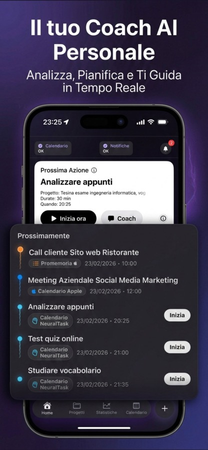
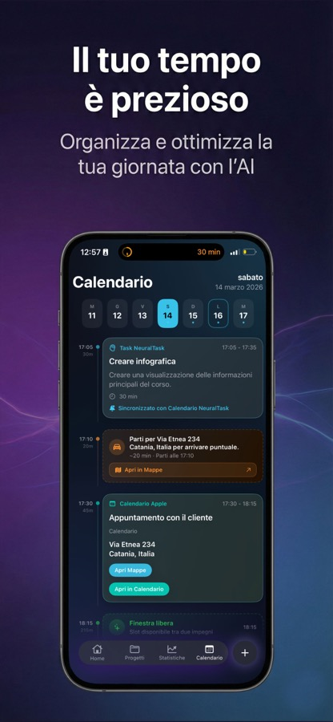
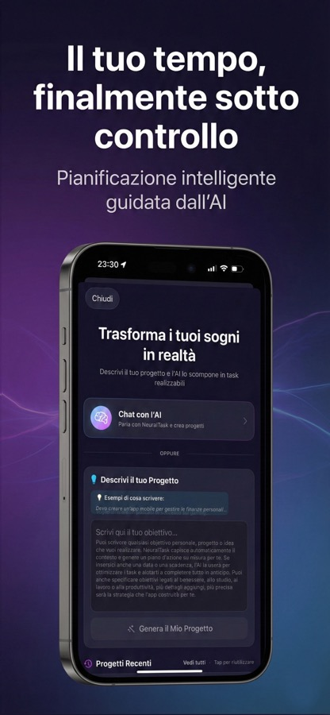
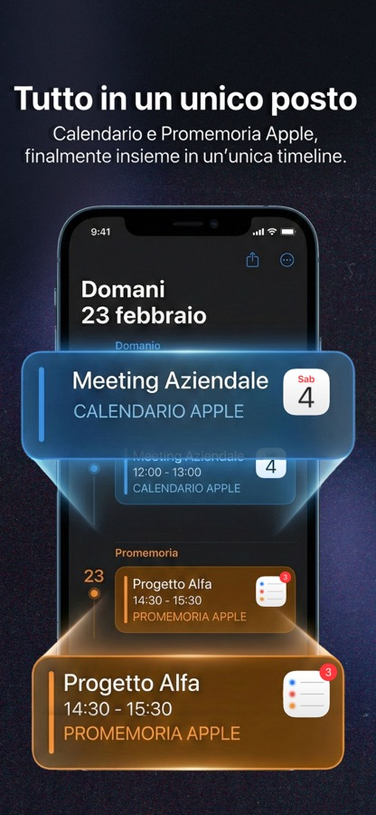

<div align="center">

# NeuralTask™

**Il sistema operativo per la tua vita.**

Un assistente AI per iOS che trasforma idee scritte male in piani che si fanno davvero.

[](https://apps.apple.com/it/app/neuraltask/id6756236022)
[](https://neuraltask.app)


</div>

---

> ### ⚠️ Questo repository non contiene il codice sorgente
>
> NeuralTask è un prodotto commerciale: il codice dell'app è privato.
> **Qui dentro trovi il prodotto, l'architettura e le decisioni tecniche** — quello che di solito si vede solo in un colloquio tecnico.
>
> Se cerchi il codice, la risposta onesta è: non c'è. Se cerchi *come è stato pensato*, sei nel posto giusto.

---

## Il problema

Avevo un problema semplice e fastidioso: **idee troppe, cose fatte poche.**

Avevo provato tutto — app di task, calendari, sistemi di pianificazione, metodologie. Il problema non è mai stato *scrivere* cosa devo fare. Il problema è stato **farlo**.

Le app di produttività ti chiedono di essere già organizzato. Le liste restano vuote. Il calendario lo riempi a mano sperando che tenga. Chiedi aiuto a un'AI e ricevi consigli generici che valgono per chiunque e quindi per nessuno.

**Nessuna app esegue al posto tuo.** Così ne ho costruita una — da solo, nel tempo libero, dal primo file alla pubblicazione sull'App Store.

## Cosa fa

Scrivi un'idea come ti viene. Anche caotica, anche incompleta.

> *"Devo lanciare il mio sito, trovare clienti, scrivere contenuti, magari fare qualche video su YouTube per farlo girare…"*

NeuralTask la trasforma in un **progetto completo**: obiettivi, macro-task, micro-task con durata stimata, difficoltà e categoria. Ogni elemento viene pianificato nelle **finestre libere reali** del tuo calendario — non in slot inventati.

Poi non si ferma. Se salti un task, se la giornata cambia, se arriva un imprevisto: **riorganizza tutto da solo** e ti dice qual è la prossima cosa da fare. Mentre dormi, il motore notturno analizza i tuoi pattern e prepara la giornata di domani.

---

## Screenshot

<table>
<tr>
<td width="50%">

<p align="center"><b>La prossima azione, non una lista</b><br/>
<sub>Una sola cosa da fare adesso, con il contesto del progetto, la durata e il momento giusto.</sub></p>
</td>
<td width="50%">

<p align="center"><b>A che ora devi partire, non solo che hai un impegno</b><br/>
<sub>NeuralTask calcola la partenza su posizione e traffico reale. E mostra le finestre libere reali.</sub></p>
</td>
</tr>
<tr>
<td width="50%">

<p align="center"><b>Da una frase a un piano</b><br/>
<sub>Scrivi l'obiettivo in linguaggio naturale. Il resto lo costruisce l'AI, on-device.</sub></p>
</td>
<td width="50%">

<p align="center"><b>Calendario e Promemoria Apple, in una timeline sola</b><br/>
<sub>L'app legge e scrive davvero sui calendari di sistema, in due direzioni.</sub></p>
</td>
</tr>
</table>

---

## I numeri

Contati sul codice, non stimati. Aggiornati alla versione **4.2.0**.

| | |
|---|---|
| **133.993** | righe di codice Swift, scritte da una persona sola |
| **250** | file Swift nell'app (+5 di test) |
| **40** | framework integrati — 31 di Apple, 9 di terze parti |
| **19** | entità di dati nel modello di persistenza |
| **9** | lingue dell'interfaccia, **3.259 stringhe** tradotte una per una |
| **83** | test automatici (unit + UI) |
| **675 KB** | di documentazione tecnica in 19 documenti |
| **4** | piattaforme: iPhone, iPad, Mac (Apple Silicon), Apple Vision |

---

## Architettura

```
┌─────────────────────────────────────────────────────────┐
│  Interfaccia            SwiftUI · 149 file              │
│  ~48.000 righe          SwiftData come stato delle view │
├─────────────────────────────────────────────────────────┤
│  Motore AI              Core ML · FoundationModels      │
│  ~46.000 righe          parsing deterministico + LLM    │
├─────────────────────────────────────────────────────────┤
│  Modelli e servizi      SwiftData · Firebase · StoreKit │
│  ~21.000 righe          19 entità · Cloud Functions EU  │
├─────────────────────────────────────────────────────────┤
│  Nucleo dell'app        EventKit · CoreLocation · MapKit│
│  ~18.000 righe          WidgetKit · ActivityKit · BGTask│
└─────────────────────────────────────────────────────────┘
```

**Stack:** Swift · SwiftUI · SwiftData · Combine · Core ML · FoundationModels · EventKit · CoreLocation · MapKit · WidgetKit · ActivityKit · BackgroundTasks · HealthKit · Speech · StoreKit 2 · Firebase (Auth, Firestore, Functions, App Check) · AdMob.

---

## L'intelligenza artificiale gira sul tuo telefono

Questa è la decisione che determina tutto il resto.

**Tre livelli, dal più privato al più potente:**

1. **Modello NLP proprietario in Core ML**, che gira sul Neural Engine. Tokenizer dedicato, generazione autoregressiva token per token. **Funziona in aereo.** Nessun dato esce dal dispositivo.
2. **`FoundationModels`**, l'LLM di sistema di Apple, per i ragionamenti più complessi — sempre on-device.
3. **Cloud opzionale**, attivabile **solo con consenso esplicito**, con i dati sanitizzati prima di uscire. Se lo rifiuti, l'app degrada con grazia: continua a funzionare, semplicemente senza quel livello.

Perché non il cloud come default? Per tre motivi concreti: **privacy** (i tuoi progetti sono tuoi), **latenza** (zero rete significa risposta immediata) e **affidabilità** (funziona in metropolitana, in montagna, in aereo).

---

## Decisioni tecniche

Le scelte che hanno richiesto più pensiero. Documentate mentre le prendevo.

### 1. L'AI non è mai la fonte di verità per i campi strutturati

Un LLM che deve compilare `startDate`, `intervalMinutes` e `weekdays` è un LLM che **prima o poi li inventa**. E una routine sbagliata è peggio di nessuna routine.

Quindi: il parsing loco è l'**unica** fonte di verità per la ricorrenza. Il modello linguistico gira solo dove serve capire l'intenzione, e per costruzione **non può** scrivere quei campi. Se l'AI non risponde, il flusso deterministico funziona lo stesso.

### 2. Il calendario è local-first: il permesso Apple non è un prerequisito

Se l'utente non concede l'accesso a Calendario, l'app **non smette di pianificare**. Il task viene comunque messo in calendario internamente, con la sua data. La scrittura sul Calendario Apple è *best-effort*: se fallisce o non c'è il permesso, il puntatore resta e viene creato dopo, in un backfill automatico.

Il risultato: **nessun task invisibile** e nessun "senza permesso non funziona niente".

### 3. Contratto "nessun tap morto"

Su una notifica si può toccare il corpo e fino a tre pulsanti. Ogni singola combinazione deve produrre un'azione reale **o** essere instradata su un fallback sensato. Mai assorbire un tap nel nulla.

Tutto passa da un unico router, con un catch-all finale che apre il calendario sul giorno. E per il caso peggiore — l'app aperta dal cold start, quando le view non sono ancora montate — i deep link vengono accodati e consumati dal primo che è pronto a riceverli.

### 4. Un solo punto di verità per il completamento di un task

Completare un task dalla checkbox, dalla notifica o dalla sessione attiva erano tre percorsi diversi che potevano divergere (storico, punteggi, apprendimento, calendario). È un bug in attesa di accadere.

Ora c'è **un solo punto runtime**. La transizione incompleto → completo passa di lì, sempre. Una risposta a una notifica arrivata dopo che la sessione è già chiusa diventa un no-op, invece di un doppio conteggio.

### 5. Migrazioni SwiftData: i campi nuovi nascono opzionali

Chi ha già l'app installata ha dati persistiti sul dispositivo. Un campo non opzionale aggiunto dopo **rompe la migrazione** e l'utente perde i suoi progetti.

Regola non negoziabile: ogni campo nuovo è `Optional`, con un fallback in lettura. Vale anche per i payload complessi, che vengono serializzati come stringa opzionale proprio per questo.

### 6. Specifica prima del codice

Ogni funzionalità non banale nasce da un documento scritto **prima** dell'implementazione, con i casi limite e la definizione di "fatto". Nella cartella `docs/` c'è una parte di quel metodo.

È un approccio lento che sembra spreco, finché non ti accorgi che è la ragione per cui il codice non è un labirinto: **l'architettura è scritta, quindi può essere verificata**. Ogni riga del documento canonico dichiara lo stato reale — implementato, parziale, dormiente — e le righe vecchie vengono corrette quando il codice le smentisce.

---

## Privacy

- L'AI lavora **sul dispositivo**. Nessun cloud obbligatorio.
- Il cloud è **opzionale**, con consenso esplicito e sanitizzazione prima dell'invio.
- La label di privacy sull'App Store dichiara esattamente cosa viene raccolto — senza giri di parole.
- Nessuna vendita dei dati a terzi.

---

## Cosa c'è in questo repository

| | |
|---|---|
| ✅ | Il prodotto: cos'è, come funziona, gli screenshot |
| ✅ | L'architettura a livello di sistema |
| ✅ | Le decisioni tecniche e il perché |
| ✅ | I numeri verificabili del progetto |
| ❌ | Il codice sorgente dell'app |
| ❌ | Il backend (Cloud Functions, regole Firestore) |
| ❌ | I modelli Core ML e il tokenizer |
| ❌ | Gli asset di design e il brand |

---

## Chi l'ha fatto

**Alessandro Di Giusto** — progettazione, sviluppo, design, backend, monetizzazione, localizzazione in 9 lingue, compliance App Store. Tutto da solo.

Di giorno lavoro nella cybersecurity, e nel tempo libero costruisco questo.

[](https://www.linkedin.com/in/alessandrodigiusto/)
[](https://github.com/Alessandro-DiGiusto)
[](https://www.alessandrodigiusto.it)

---

<div align="center">
<sub>© 2026 Alessandro Di Giusto · NeuralTask™ è un prodotto proprietario.<br/>
Nessuna parte di questo repository può essere riutilizzata senza autorizzazione scritta.</sub>
</div>
